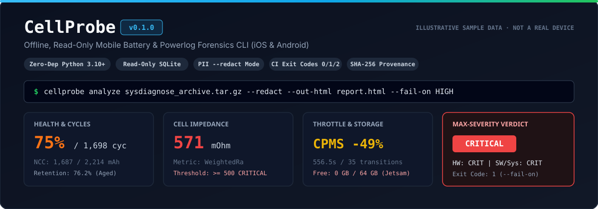
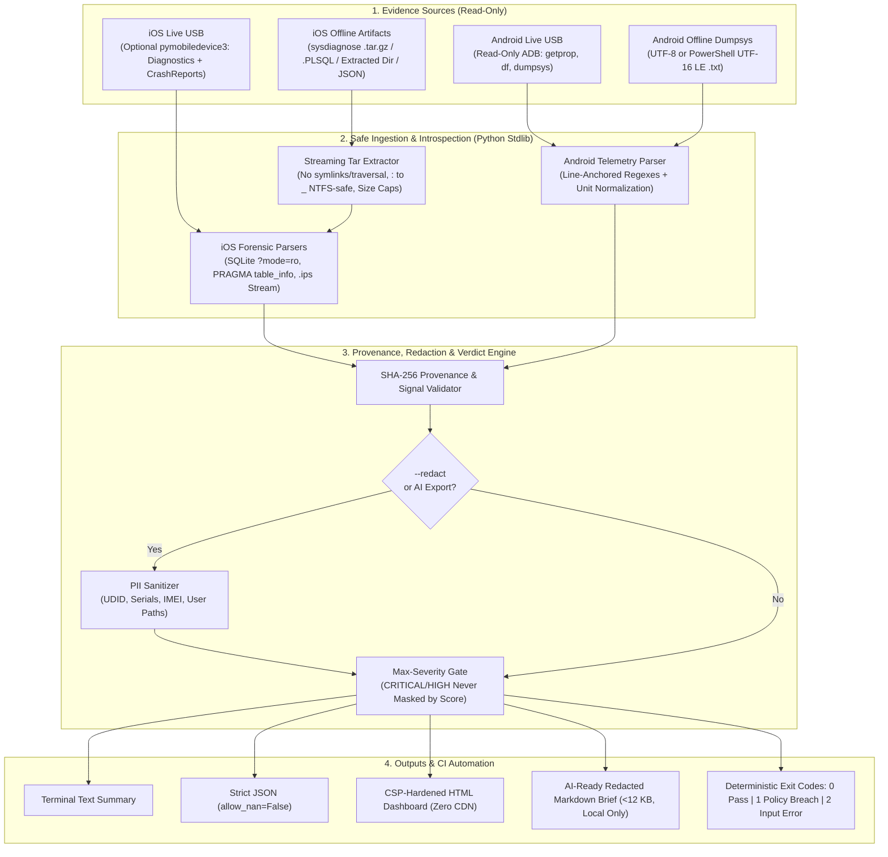

<p align="center">
  
</p>

<p align="center">
  <a href="https://github.com/Mitsaken/cellprobe/actions/workflows/ci.yml"></a>
  
  
  
  
  
</p>

# CellProbe

**Offline-first, read-only mobile battery, Powerlog, thermal, storage, and radio diagnostic CLI for iOS and Android — built on a zero-dependency Python Standard Library core.**

Designed for battery health screening, overnight standby-drain root-cause analysis, and safer secondhand device checks without cloud uploads or destructive device writes.

---

## Why CellProbe?

Consumer battery screens only show a rounded percentage (`Maximum Capacity %`), hiding the real physical and software drivers behind sudden shutdowns, overheating, and rapid drain:

- **Internal Cell Impedance (`WeightedRa`):** Aged cells exhibit sharp voltage sags under load (`ΔV = I × R`) even when OS Health still reads `78–83%`.
- **Active `CPMS` Throttling:** iOS Powerlog tracks exact CPU/GPU peak-power reduction durations (`-10%` to `-49%` and `50+%` bins) triggered by cell impedance or thermal stress.
- **Storage Pressure & Wake Storms:** Critically low free flash space (`<= 1 GB`) triggers `Jetsam` kills and `cache_delete` churn, while lock-screen Astronomy posters, background location clients, push wake storms, `'Hey Siri'` DSP triggers, `ipsec`/`utun` tunnels, and `<= 2 bars` cellular towers silently drain standby charge.
- **Android Hardware & `batterystats` Separation:** Parses `dumpsys battery`, `sysfs` design capacity, compact multi-unit `batterystats` durations (`+1d2h3m4s500ms`), wakelocks, UID power share, and Windows PowerShell UTF-16 LE dumps cleanly offline or via read-only `adb`.

---

## Architecture



---

## Installation

### 1. Offline Analysis & Android (Zero Python Dependencies)

```bash
git clone https://github.com/Mitsaken/cellprobe.git
cd cellprobe
python scripts/cellprobe.py --help
```

Or install cleanly in editable mode (core has `dependencies = []`):

```bash
pip install --no-deps -e .
cellprobe --help
```

### 2. Live iOS USB Scanning (Optional)

```bash
pip install -e ".[ios]"
# Installs optional pymobiledevice3>=5.0.0,<12 (GPL-3.0-or-later) for USB transport only
```

For live Android scanning, ensure Android Platform Tools (`adb`) is available on your `PATH` (or standard Android SDK folders on Windows, macOS, or Linux) and USB Debugging is enabled on the phone.

---

## Quick Start

### Try Bundled Synthetic Fixtures Immediately

```bash
python scripts/cellprobe.py analyze examples/sample_ios_quick.json --redact --format text
python scripts/cellprobe.py analyze examples/sample_android_dump.txt --format text
```

### Offline `sysdiagnose` / Powerlog / `dumpsys` Analysis

```bash
# Full redacted audit producing CSP-hardened HTML + AI-ready Markdown brief + strict JSON
python scripts/cellprobe.py analyze path/to/sysdiagnose.tar.gz --redact --out-html report.html --out-ai brief.md --out-json report.json

# Direct read-only SQLite analysis on CurrentPowerlog.PLSQL
python scripts/cellprobe.py analyze path/to/CurrentPowerlog.PLSQL --format text --fail-on HIGH

# Capture Android dump locally (even Windows PowerShell UTF-16 redirection works) and inspect
adb shell dumpsys battery > android_dump.txt
adb shell dumpsys batterystats --charged >> android_dump.txt
python scripts/cellprobe.py analyze android_dump.txt --format html --out-html android_report.html
```

### Live USB Diagnostics

```bash
# Auto-detect single connected iPhone (USB) or Android device (ADB)
python scripts/cellprobe.py scan --redact

# Live iOS USB hardware read + read-only pull (erase=False) of latest completed sysdiagnose
python scripts/cellprobe.py ios --deep --redact --out-dir ./capture_ios --out-html iphone_report.html

# Inspect iPhone 14 or older hardware rated by Apple at 500 nominal charge cycles
python scripts/cellprobe.py ios --cycles-high 500 --redact

# Live Android ADB capture
python scripts/cellprobe.py android --out-dir ./capture_android --out-html android_report.html
```

> **Windows `usbmuxd` Error 183 Note:** On Windows 10/11, `pymobiledevice3` pairing can trigger `SavePairRecord` Error 183 when Apple Mobile Device Service already holds a pair record. CellProbe automatically reuses existing Lockdown records from `~/.pymobiledevice3` or `%ProgramData%\Apple\Lockdown` with `autopair=False` (falling back to `autopair=True` if a cached record is revoked).

---

## Interpreting Forensic Metrics

CellProbe distinguishes between **system-reported Apple / Android flags** and **empirical diagnostic thresholds** (adjustable via CLI flags):

| Metric | Physical / System Meaning | Data Source (`iOS` / `Android`) | Indicative Thresholds |
| :--- | :--- | :--- | :--- |
| **`WeightedRa`** | Compensated internal cell resistance in milliohms (`mOhm`). Higher impedance drives `I × R` voltage sag under burst load. | `AppleSmartBattery`, `BatteryConfig`, `Analytics-*.ips*` | `< 350 mOhm`: Normal aging<br>`350–499 mOhm`: `HIGH` elevated impedance<br>`>= 500 mOhm`: `CRITICAL` sag risk *(empirical defaults)* |
| **`CPMS` Reduction** | Observed Closed-loop Power Management throttling seconds across reduction bins (`10–49%`, `50+%`, `50–100%`) & Peak Power transitions (does not assign single root cause alone). | `PPMStatsCPMSPowerReduction`, `PPMStatsPeakPowerPressure`, `.BGSQL` | Any active reduction `> 0.5s`, peak transition, or `.BGSQL > 20` fallback flags `CRITICAL` |
| **`LifetimeUPOCount`** | Cumulative historical Unexpected Power-Off crashes caused by peak voltage sag (never resets over device lifetime; delta between captures matters most). | `PLBatteryAgent_EventNone_BatteryConfig` | `0`: Clean history<br>`>= 1`: Historical UPO indicator (`CRITICAL` check) |
| **`BatteryAuth` & Service** | Apple cryptographic battery controller verification (`BatteryAuth`) and OS service flag (`ServiceOption`). | `EPSQL BDC_Weekly`, `BatteryHealth.log`, `BatteryConfig` | `BatteryAuth == 0`: `CRITICAL` unverified cell<br>`service_state >= 1`: `HIGH` OS service flag |
| **`CycleCount` vs `NCC`** | Total charge-equivalent cycles vs actual `NominalChargeCapacity` (`mAh`) retention against factory `DesignCapacity`. | `BatteryConfig`, `EPSQL BDC_Once`, Android `sysfs` / `dumpsys` | Apple rates iPhone 14 & earlier at `500` cycles and iPhone 15+ at `1000` cycles (override via `--cycles-high`) |
| **Free Storage & `Jetsam`** | Available NAND space affecting virtual-memory swaps, `cache_delete` churn, and `Jetsam` process kills. | `PLConfigAgent_EventNone_Config`, Android `df -k /data` | `< 5 GB`: `HIGH` low space<br>`<= 1 GB`: `CRITICAL` storage exhaustion risk |

---

## How CellProbe Compares

| Dimension | **CellProbe v0.1.0** | **`pymobiledevice3`** | **`APOLLO`** | **`coconutBattery`** | **OS Battery Settings** |
| :--- | :--- | :--- | :--- | :--- | :--- |
| **Primary Role** | Offline & live battery/Powerlog root-cause CLI & report generator | General iOS USB/RSD protocol toolkit | SQLite forensic timeline extractor | macOS desktop GUI battery monitor | Basic end-user indicator |
| **OS Support** | **Windows, Linux, macOS** | Windows, Linux, macOS | Windows, Linux, macOS | **macOS only** | On-device only |
| **Android Support** | Yes (`adb` live + offline `dumpsys`) | No | No | No | On-device only |
| **Core Runtime Deps** | **0 (Python 3.10+ stdlib)**; optional `pymobiledevice3` for iOS USB | Multiple (`cryptography`, `construct`, etc.) | External Python libraries | Closed-source macOS app | Built-in OS |
| **Root-Cause Verdicts** | Max-severity gating (`WeightedRa`, `CPMS`, UPO, storage, wakes, radio) | Raw IORegistry / plist dumps | Raw SQL rows without scoring | Health %, cycles, mAh (no Powerlog) | Single rounded % + generic alerts |
| **Automation & Privacy** | `--fail-on`, exits `0/1/2`, `--redact`, `source_sha256`, CSP HTML | Custom scripting needed | Partial CSV/SQLite | GUI only | None |
| **License** | **MIT** | GPL-3.0 | MIT | Proprietary | Proprietary |

> CellProbe complements **`pymobiledevice3`** rather than replacing it: when live iOS USB capture is requested, CellProbe uses `pymobiledevice3` strictly as an optional read-only transport layer and adds cross-platform Powerlog SQLite parsing, Windows tar safety, deterministic triage rules, and redacted HTML/JSON exports.

---

## Configurable Thresholds & CI Exit Codes

| Flag | Default | Validation & Role |
| :--- | :--- | :--- |
| `--health-warn` | `80` | Integer `1..100` (`>= --health-crit`) — Battery health `%` warning (`HIGH`) |
| `--health-crit` | `75` | Integer `1..100` (`<= --health-warn`) — Severe degradation health `%` gate (`CRITICAL` when combined with high cycles) |
| `--cycles-high` | `1000` | Integer `> 0` — Cycle count threshold (use `500` for iPhone 14 and earlier) |
| `--resistance-warn` | `350` | Integer `> 0` (`<= --resistance-crit`) — `WeightedRa` warning (`mOhm`, `HIGH`) |
| `--resistance-crit` | `500` | Integer `> 0` — `WeightedRa` critical impedance (`mOhm`, `CRITICAL`) |
| `--min-free-gb` | `5` | Integer `> 0` — Low storage warning (`GB`; `<= 1 GB` triggers `CRITICAL`) |
| `--poor-signal-warn` | `35.0` | Finite float `(0..100]` — Cellular `<= 2 bars` share warning (`%`) |
| `--max-wakes-per-hr` | `8.0` | Finite float `> 0` — Standby wakeup rate warning (`>= 1.0h` span required) |
| `--fail-on` | `NONE` | Exit `1` if verdict `>=` `MEDIUM`, `HIGH`, or `CRITICAL` |
| `--redact` | `False` | Scrubs `udid`, `battery_serial`, `device_name`, `serial`, `imei`, `iccid`, `meid` & home paths |

All numeric CLI arguments reject `NaN`, `inf`, `-inf`, and non-positive or out-of-range inputs cleanly with exit code `2` and zero Python tracebacks.

**Process Exit Codes:**
- `0`: Completed cleanly (verdict below `--fail-on` policy, or `--fail-on NONE`).
- `1`: Findings met or exceeded the `--fail-on` threshold (fail-closed if verdict is unknown).
- `2`: Invalid CLI usage, missing/corrupt input artifact, empty dump, or live collection error.

---

## Supported & Verified Scope

| Target / Environment | Evidence Status | Notes |
| :--- | :--- | :--- |
| **iOS `26.6.2` & `27.0.1` (`sysdiagnose`)** | Real-device verified | Tested end-to-end against pulled iPhone 12 mini & iPhone SE (2020) `.tar.gz` archives |
| **Legacy iOS SQLite & Open CPMS (`50+%`)** | Unit-test verified | Covered via synthetic SQLite schema-fallback & open-ended CPMS tests |
| **Android `dumpsys` & PowerShell UTF-16 LE** | Fixture verified | Covered via `examples/sample_android_dump.txt` + synthetic multi-unit/negative-temp fixtures |
| **Windows 11 / Python 3.14 local runner** | Live verified | Pure stdlib test suite, Windows path sanitization, read-only SQLite URIs |
| **Ubuntu / Windows / macOS (`3.10`, `3.13`)** | CI workflow configured | Defined in `.github/workflows/ci.yml` |

### What CellProbe Is Not
- **Not an external LLM client:** `--format ai` and `--out-ai` generate a **100% local, redacted `<12 KB` Markdown/JSON diagnostic brief** for you to inspect or paste manually — CellProbe never makes network calls or uploads telemetry anywhere.
- **Not a court-certified digital forensics suite or hardware multimeter:** Verdicts combine exact device counters (`CycleCount`, `WeightedRa`, `LifetimeUPOCount`, `RemainingDiskSpace`) with configurable heuristic thresholds for triage and maintenance decisions.
- **Not a destructive cleaner or repair tool:** All SQLite connections use `?mode=ro` + `PRAGMA query_only = ON`, and live iOS pulls enforce `erase=False`.

---

## Privacy, Security & Git Hygiene

- **Tar Bomb & NTFS Protection:** Lazy streaming extraction enforces `<= 150 MB` per file, `<= 400` extracted members, `<= 512 MB` cumulative extraction, rejects `..` traversals, symlinks, hardlinks, `._*` AppleDouble files, Windows illegal characters, and reserved device names (`CON`, `NUL`, `COM*`, `LPT*`), and maps `:` to `_` for Windows NTFS compatibility.
- **CSP-Hardened Standalone HTML:** Reports escape all untrusted fields with `html.escape()` and embed a strict `Content-Security-Policy` (`default-src 'none'; style-src 'unsafe-inline'; img-src data:;`).
- **Evidence Traceability:** File analyses record `source_sha256` alongside `generated_at` UTC timestamps. `--redact` recursively scrubs listed device identifiers (`udid`, `battery_serial`, `device_name`, `serial`, `imei`, `iccid`, `meid`) and local user home paths across report strings (app bundle IDs and location client names in activity tables are preserved unless excluded manually).
- **Repository Hygiene:** `.gitignore` blocks `*.tar.gz`, `*.tgz`, `*.PLSQL`, `*.EPSQL`, `*.BGSQL`, `*.ips`, `*.synced`, `pulled/`, `extracted/`, and `*_report.*` to prevent accidental commits of personal logs.

---

## Testing & Verification

Run the stdlib unit test suite (**11 tests** in `tests/test_cellprobe.py`):

```bash
python -B -m unittest discover -s tests -p "test*.py" -v
```

See [examples/walkthrough.md](examples/walkthrough.md) for captured terminal reports and exit-code examples using the bundled synthetic fixtures.

---

## License & Third-Party Notices

- **CellProbe Core:** Licensed under the [MIT License](LICENSE) (Copyright (c) 2026 Mitsaken / Conversionlogic).
- **Optional Live iOS USB Transport:** `pymobiledevice3` (`>=5.0.0,<12`, installed only when opting into `pip install ".[ios]"`) is licensed under **GPL-3.0-or-later**. Combined binary distributions bundling `[ios]` dependencies must satisfy GPL-3.0-or-later terms.
